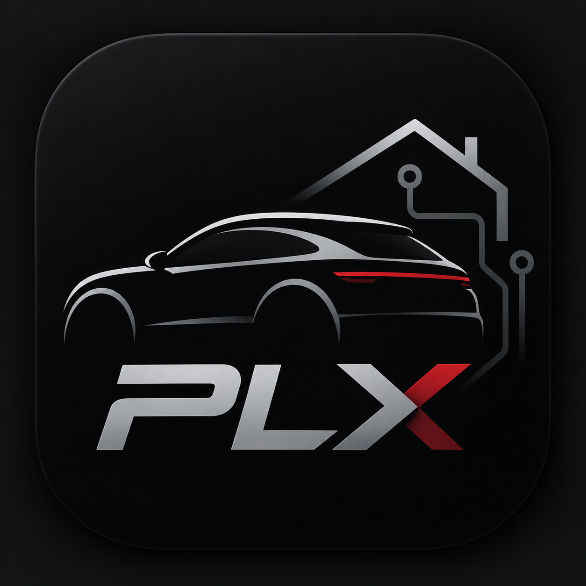

<p align="center"></p>
<h1 align="center">PLX</h1>
<p align="center"><strong>Porsche-Connect-Status – mit genau den MQTT-Werten, die dein Zuhause braucht.</strong></p>
<p align="center"><a href="#schnellstart">Schnellstart</a> · <a href="INSTALL.de.md">Installation</a> · <a href="docs/MANUAL.de.md">Handbuch</a> · <a href="README.md">English</a></p>

**Docker 0.1.3 Preview** · [Downloads & Prüfsummen](https://github.com/square-com-de/plx/releases/tag/v0.1.3) · [Release-Stand](RELEASE.md)

Betreibe PLX auf deinem eigenen Server, sieh die von deinem Porsche gemeldeten Daten und wähle aus, was Loxone oder ein anderer MQTT-Empfänger erhalten soll. Docker und das LoxBerry-4-Plugin verwenden dieselbe deutsche und englische Weboberfläche.

## Ein Blick auf PLX


*Die echte PLX-Oberfläche mit simulierten Messwerten, kein Screenshot eines angemeldeten Nutzerkontos. Das Modellbild stammt aus Porsche Connect. Verfügbare Daten hängen von Fahrzeug und Connect-Vertrag ab.*

## Was du damit machen kannst

- **Das Wesentliche sehen:** Batterie, Reichweite, Ladeziel und Messalter in einer kompakten Übersicht.
- **Deine Fahrzeuge auswählen:** Mit dem eigenen Porsche-Konto anmelden und dessen Fahrzeugbilder anzeigen.
- **Gemeldete Daten erkunden:** Parameter wie Reifen, Laden, Türen, Klima, Fahrten und Wartung durchsuchen und filtern, soweit unterstützt.
- **Nur gewählte MQTT-Werte senden:** Zwei ausgewählte Reifendrücke ergeben im einfachen Modus zwei numerische Wert-Topics in bar.
- **Loxone-Eingänge vorbereiten:** Ausgewählte numerische Werte als XML/CSV exportieren; für Frischesignale gibt es ausführliches MQTT.
- **Eine Oberfläche in zwei Sprachen nutzen:** Deutsch/Englisch, in Docker oder als LoxBerry-4-Plugin.

PLX liest Statusdaten; es steuert das Fahrzeug nicht fern und weckt es nicht auf. **Porsche-Cloud und ein kompatibles Porsche-Connect-Konto bleiben erforderlich.** Ein eigener PLX-Server macht die Fahrzeug-API nicht lokal.

## Schnellstart

Für eine **frische Installation** auf einem Linux-Host mit Docker Compose und `curl`. Eine Administratorshell mit Docker-Zugriff verwenden. Das öffentliche Image benötigt kein GitHub-Konto und keinen Registry-Token.

**192.0.2.10** unten durch die IP oder den DNS-Namen deines Docker-Servers ersetzen, ohne `https://`, Pfad oder Port. Ein DNS-Name muss im Browser bereits auf diesen Server auflösen. In einem neuen Verzeichnis ausführen:

```sh
set -eu
mkdir plx && cd plx
curl -fLO https://github.com/square-com-de/plx/releases/download/v0.1.3/compose.yaml
printf 'PLX_HOST=192.0.2.10\n' > .env
docker compose up -d --wait --wait-timeout 90
docker compose exec -T plx cat /data/config/web-password.txt
```

1. **`https://<dein-server>:8443`** öffnen.
2. **Vor der Eingabe von Zugangsdaten dem eigenen Serverzertifikat ausdrücklich vertrauen.** PLX erzeugt ein passendes selbstsigniertes Zertifikat, dem Browser nicht automatisch vertrauen. Den Fingerabdruck am Server mit `docker compose exec -T plx openssl x509 -in /data/tls/cert.pem -noout -fingerprint -sha256` prüfen. Anschließend den Zertifikats-Vertrauensweg deines Geräts oder ein geeignetes eigenes vertrauenswürdiges Zertifikat nutzen. TLS-Prüfung nicht abschalten. Siehe [HTTPS und Erststart](INSTALL.de.md#start).
3. Als **`admin`** mit dem Passwort aus dem letzten Befehl anmelden. Es wird bewusst nur in deiner Serverkonsole angezeigt; privat aufbewahren.

PLX erzeugt Passwort und TLS-Dateien einmalig in einem **persistenten benannten Volume**, zusammen mit Einstellungen und einer gegebenenfalls gespeicherten Porsche-Sitzung. Compose-Verzeichnis/Projekt und Volume bei Updates erhalten; kein `down -v` verwenden. [Sicherung, Update und Rückweg](INSTALL.de.md#update-sicherung-und-rückweg).

Das ist der dokumentierte Release-Compose-Weg mit [historischen Schnellstart-Nachweisen](docs/QUICKSTART-0.1.2.md). Eine frische Installation des exakten 0.1.3-Images hat zusätzlich [Portainer-, Anmelde-, Neustart- und HTTPS-Proxy-Prüfungen](docs/DEPLOYMENT-0.1.3.md) bestanden. Die Berichte beschreiben ihren tatsächlichen Umfang, nicht jeden Host oder Installationsweg.

## Erste Nutzung

1. Unter **Porsche-Konto** bei Porsche anmelden und bei Bedarf CAPTCHA bestätigen.
2. Fahrzeuge laden, die gewünschten unter **Einrichtung** auswählen und speichern.
3. Fahrzeugstatus und Messalter ansehen. Automatischer Abruf und MQTT starten **deaktiviert**; den Abruf bei Bedarf einschalten.
4. Zur Datenweitergabe den tatsächlichen MQTT-Broker eintragen, nur die gewünschten Werte auswählen, dann MQTT aktivieren und speichern. Einfaches MQTT ist der Standard. `porsche2lox/#` oder den eigenen Präfix abonnieren.

Eine Webproxy-Adresse ist nicht automatisch ein MQTT-Broker. PLX verwendet eine eigene Sitzung und eigene Topics; eine andere Integration wird nicht automatisch migriert oder ersetzt. [MQTT-Einrichtung und Fehlerbehebung](docs/MANUAL.de.md#mqtt-und-loxone).

## Weitere Installationswege

| Deine Umgebung | Einstieg |
| --- | --- |
| Portainer | [Separaten Stack anlegen](INSTALL.de.md#portainer), Release-Compose verwenden, `PLX_HOST` setzen und das Passwort in der Containerkonsole lesen. |
| LoxBerry 4 | [PLX-LoxBerry-0.1.4-New-Installation.zip importieren](https://github.com/square-com-de/plx/releases/download/v0.1.4/PLX-LoxBerry-0.1.4-New-Installation.zip), über die Pluginverwaltung – nicht GitHubs Quellcode-ZIP. [Installation](INSTALL.de.md#alternativen-und-grenzen). |
| LoxBerry hinter einem HTTPS-Proxy | [Unmittelbaren vertrauenswürdigen Proxy konfigurieren](docs/REVERSE-PROXY.md); die Plugininstallation allein erkennt deinen Proxy nicht. |
| Proxmox oder eigene Container-Einrichtung | [Anleitung für Container, Sicherung und Rückweg](docs/PROXMOX-CONTAINER.de.md). Docker in einer Linux-VM betreiben, nicht auf dem Hypervisor. |

PLX im vertrauenswürdigen LAN betreiben. Andere Ports, Zertifikatswechsel, Reverse Proxies und bestehende ausdrücklich gesetzte Passwort-Secrets stehen in der [Installation](INSTALL.de.md) und [Docker-Referenz](docs/DOCKER.md).

## Grenzen der Preview

**0.1.3 ist Preview, nicht Stable.** Für Linux/AMD64 liegen Laufzeitnachweise vor. AMD64-/ARM64-Images sind veröffentlicht; echter ARM64-Betrieb, Podman/Rootless und native Installation außerhalb LoxBerry sind weiterhin nicht abgenommen. Die vollständige Abnahme über MQTT Gateway bis zum Loxone-Miniserver bleibt offen. Eine erfolgreiche Installation beweist keinen echten Porsche-Login, keine Token-Erneuerung und keine Unterstützung jedes Modells. [Release-Hinweise](docs/RELEASE-0.1.3.md) · [Tests](docs/TESTS.md).

**Für Automationen, die frische Daten brauchen:** Einfaches MQTT sendet den zuletzt gemeldeten Wert oder bei fehlenden Werten `null`, ohne Heartbeat-/Verfügbarkeitstopics. Gespeicherte Brokerwerte können nach Containerstopp oder Verbindungsabbruch bestehen bleiben. Alter/Status in PLX prüfen oder das ausführliche Format für Frischesignale verwenden. Ein Cloud-Abruf ist keine neue Fahrzeugmessung. [Handbuch](docs/MANUAL.de.md).

## Dokumentation

| Thema | Anleitung |
| --- | --- |
| Installation, Updates und Wiederherstellung | [Installation](INSTALL.de.md) · [Containerbetrieb](docs/PROXMOX-CONTAINER.de.md) |
| Bedienung und Fehlerbehebung | [Handbuch](docs/MANUAL.de.md) |
| MQTT, XML und Loxone-Zuordnung | [Loxone-Referenz](docs/LOXONE.md) |
| Architektur, Anmeldung und Datenqualität | [Technische Referenz](docs/TECHNICAL.de.md) |
| Releases und Änderungen | [Release-Übersicht](RELEASE.md) · [Changelog](CHANGELOG.md) |
| Geprüfte Abläufe und Erfahrungen | [Erfahrungen aus Installationen](docs/INSTALLATION-LESSONS.de.md) · [0.1.1](docs/QUICKSTART-0.1.1.md) · [0.1.2](docs/QUICKSTART-0.1.2.md) · [0.1.3-Artefakte](docs/QUICKSTART-0.1.3.md) · [0.1.3-Installation](docs/DEPLOYMENT-0.1.3.md) |

## Hilfe und Mitmachen

Fragen, Fehlermeldungen und Feedback sind willkommen: [GitHub Issues](https://github.com/square-com-de/plx/issues/new/choose) oder [plx@square-com.de](mailto:plx@square-com.de), auch ohne GitHub-Konto. Hilfreich sind PLX-Version, Docker-/LoxBerry-Umgebung, Fahrzeugmodell und eine kurze Beschreibung.

Porsche-ID, Fahrzeugnummer, Standort, Passwörter und Tokens aus Screenshots und Logs entfernen. Keine Einstellungsdateien, privaten Schlüssel oder Sicherungen hochladen. Sicherheitsprobleme vertraulich über [SECURITY.md](SECURITY.md) melden.

Du möchtest helfen? Einstieg über [Mitwirken](CONTRIBUTING.md) und die [automatischen Prüfungen](https://github.com/square-com-de/plx/actions/workflows/docker.yml). Grüne CI ersetzt keine Fahrzeug- oder Miniserver-Abnahme.

## Lizenz

Der eigene PLX-Code steht unter [MIT](LICENSE), einschließlich kommerzieller Nutzung unter den Bedingungen. Abhängigkeiten und Fremdgrafiken behalten ihre eigenen Bedingungen: [Dritthinweise](THIRD-PARTY-NOTICES.md). MIT erteilt keine Rechte an Porsche-Markenzeichen oder -Grafiken.

Unabhängiges Projekt; keine offizielle Verbindung zu oder Unterstützung durch Porsche oder Loxone.

<p align="center"><strong>by <a href="https://square-com.de/">square | com</a></strong> · <a href="https://square-com.de/impressum/">Impressum</a></p>
