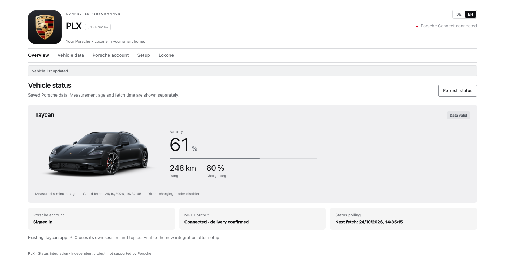

> **PLX 0.1.0 Preview** — [Downloads and checksums](https://github.com/square-com-de/plx/releases/tag/v0.1.0). Not a stable release. Docker image: `ghcr.io/square-com-de/plx:0.1.0` (AMD64/ARM64), public pull without a GitHub token. [Status and acceptance](RELEASE.md).

<a href="README.de.md">Deutsch</a> | <a href="README.md">English</a>

<h1 align="center">PLX</h1>

Your Porsche x Loxone in your smart home.

<a href="docs/MANUAL.md">Manual</a> · <a href="INSTALL.md">Installation</a> · <a href="RELEASE.md">Release status</a>

**Your Porsche data in one place. Select what your smart home receives.**

PLX brings Porsche Connect vehicle data into a compact dashboard and into Loxone over MQTT. Check battery level, range and tire pressure, browse the measurements your vehicle reports, and choose exactly which values to send.

Run PLX as a standalone Docker container or a LoxBerry 4 plugin. Both use the same German/English web interface, your own Porsche session and a separate MQTT namespace. Vehicle images come from your signed-in Connect account.

PLX runs on your own server. **Vehicle data still comes from the Porsche cloud** and requires a compatible Porsche Connect account. PLX reads status only; it does not remote-control or wake your car.

## Features

- Sign in to Porsche, complete a CAPTCHA if requested, and keep your session across restarts.
- Select vehicles and see their model image, battery, range and reported measurement age.
- Search and filter available vehicle parameters, including tire pressure, charging, doors, climate, trips and maintenance where supported.
- Select exactly what MQTT sends: two selected tire pressures produce two numeric topics in bar.
- Use optional detailed diagnostics or export selected numeric inputs as Loxone XML/CSV.
- Switch between German and English; your browser remembers your choice.
- Run over HTTPS in Docker on AMD64/ARM64 or as a LoxBerry 4 plugin.

## Preview

*Example measurements are simulated; the vehicle illustration comes from Porsche Connect. Available parameters depend on your car and Connect contract.*

## Install and get started

**LoxBerry import:** [Download PLX-LoxBerry-0.1.0.zip](https://github.com/square-com-de/plx/releases/download/v0.1.0/PLX-LoxBerry-0.1.0.zip). Upload unchanged in the plugin manager; do not use GitHub’s generic source ZIP.

| Installation method | Who is it for? | Guide |
| --- | --- | --- |
| **Docker / Compose** | Your own server or existing container environment, including Portainer. No LoxBerry required. | [Installation](INSTALL.md) · [Docker details](docs/DOCKER.md) |
| **LoxBerry plugin** | An existing LoxBerry 4 installation with HTTPS. | [Installation](INSTALL.md#loxberry-plugin) |

1. **Install PLX:** choose Docker or the plugin. Use a versioned artifact and check its checksum from the release.
2. **Open the interface:** Docker uses your own PLX username/password; the plugin uses your LoxBerry web login. There is no default PLX password.
3. **Connect Porsche:** sign in, load vehicles, choose your vehicle in Setup and save.
4. **Choose MQTT values:** configure your broker, select only the values you want under Loxone and save. Subscribe to `<prefix>/#`, default `porsche2lox/#`.

Polling and MQTT start disabled. The optional Loxone XML/CSV export helps with MQTT Gateway and virtual UDP inputs; it is not required for MQTT itself.

**Already installed?** Back up your PLX data before updating. Follow [installation and updates](INSTALL.md#updates-and-backup). Existing detailed MQTT configurations keep their format unless you change it.

## Feedback & contact

Tried PLX? Feedback is welcome — including what works well!

- **By email, no GitHub account needed:** [plx@square-com.de](mailto:plx@square-com.de)
- [Feedback or questions](https://github.com/square-com-de/plx/issues/new?template=feedback_question.md)
- [Report a bug or suggest an improvement](https://github.com/square-com-de/plx/issues/new/choose)

Include your PLX version, Docker or LoxBerry setup, vehicle model and a short description. Remove Porsche IDs, VINs, locations, passwords and tokens from screenshots or logs. Report security issues privately; see [security reporting](SECURITY.md).

## Release status and limits

**0.1.0 Preview.** Separate Docker and LoxBerry test installations verified sign-in, vehicle/status fetch, HTTPS, DE/EN, mobile layout and exactly two numeric pressure messages at a broker. Real LoxBerry clean-install and update tests found and fixed an update-state-loss issue. Settings and the Porsche session now survive the official installer’s purge step.

A complete MQTT Gateway → Loxone Miniserver acceptance test remains open. Tests do not qualify every Porsche model, contract or future API version. See [release notes](docs/RELEASE-0.1.0.md) and [test evidence](docs/TESTS.md).

**Freshness matters:** simple MQTT sends the last reported value and `null` for missing values. It has no heartbeat or availability topics; retained values remain after a stopped container or failed connection. Check age/status in PLX or use detailed mode when your automation requires freshness signals. A cloud refresh is not a new vehicle measurement.

PLX uses its own session and topics. It does not import or replace an existing Taycan integration automatically.

## Documentation

| Topic | Start here |
| --- | --- |
| Setup, Docker and LoxBerry | [Installation](INSTALL.md) |
| Everyday use and troubleshooting | [Manual](docs/MANUAL.md) |
| Container, HTTPS, volumes and registry | [Docker guide (German)](docs/DOCKER.md) |
| MQTT, XML and Loxone mapping | [Loxone guide (German)](docs/LOXONE.md) |
| Architecture, authentication and data quality | [Technical reference (German)](docs/TECHNICAL.de.md) |
| Current preview and downloads | [Release overview](RELEASE.md) |
| Changes | [Changelog](CHANGELOG.md) |
| Tests and contributions | [Contributing](CONTRIBUTING.md) |
| Sources and third-party assets | [Third-party notices](THIRD-PARTY-NOTICES.md) |

## Quality and security

[GitHub checks](https://github.com/square-com-de/plx/actions/workflows/docker.yml) run the tests, build and smoke-test the standalone container, then publish AMD64/ARM64 development images. Release images are public; no registry login is required. Passing CI is not a complete vehicle or Miniserver acceptance test.

Never upload Porsche tokens, private keys, settings files or private backups to issues or pull requests. See [security reporting](SECURITY.md).

## License

PLX’s own code is licensed under [MIT](LICENSE), including commercial use under its terms. Third-party dependencies and Porsche branding retain their own terms; see [notices](THIRD-PARTY-NOTICES.md). The MIT license does not grant rights to Porsche trademarks or artwork.

Independent project; not affiliated with or supported by Porsche or Loxone.

<strong>by <a href="https://square-com.de/">square | com</a></strong> · <a href="https://square-com.de/impressum/">Impressum / Legal notice</a>

